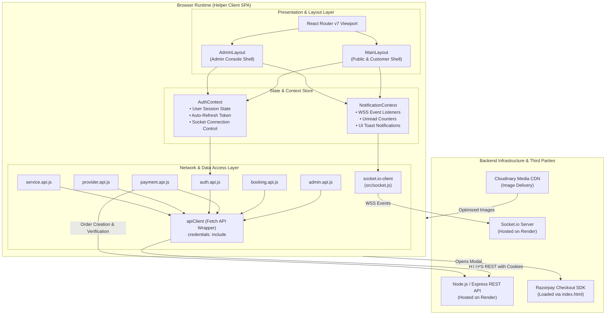
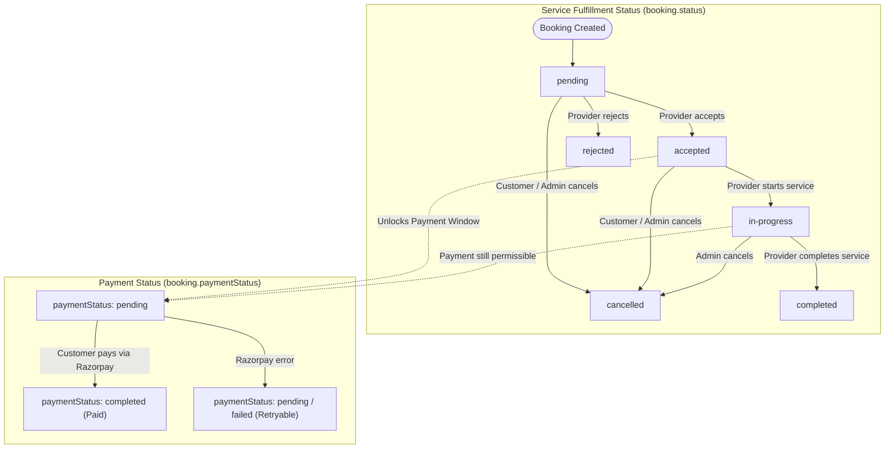
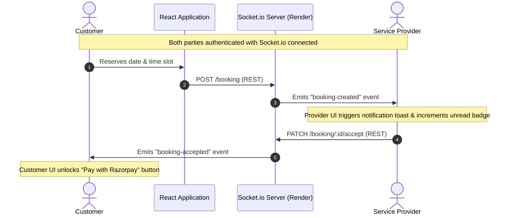

# Helper — Full-Stack Service Marketplace (Frontend)

<div align="center">

[](https://helper-ten-kappa.vercel.app/)
[](https://react.dev/)
[](https://vite.dev/)
[](https://tailwindcss.com/)
[](https://reactrouter.com/)
[](https://socket.io/)
[](https://razorpay.com/)

<p align="center">
  <strong>A full-stack, on-demand service marketplace bridging Customers, Service Providers, and Platform Administrators.</strong>
  <br />
  Featuring dynamic calendar-slot booking, Razorpay payment gateway integration over HTTPS, duplex WebSocket notifications, cloud media delivery, and an administrative moderation console.
</p>

</div>

---

## 📑 Table of Contents

- [Overview & Problem Solved](#-overview--problem-solved)
- [System Architecture & Data Flows](#-system-architecture--data-flows)
  - [1. High-Level Architectural Blueprint](#1-high-level-architectural-blueprint)
  - [2. Actual Booking & Payment Lifecycle](#2-actual-booking--payment-lifecycle)
  - [3. Real-Time WebSocket Event Pipeline](#3-real-time-websocket-event-pipeline)
- [Portal Deep-Dives & Key Workflows](#-portal-deep-dives--key-workflows)
  - [1. Customer Experience Portal](#1-customer-experience-portal)
  - [2. Service Provider Workspace](#2-service-provider-workspace)
  - [3. Administrator Governance Console](#3-administrator-governance-console)
- [Key Implementations & Architecture Details](#-key-implementations--architecture-details)
  - [Dual-Channel Networking Layer](#1-dual-channel-networking-layer)
  - [Dynamic Calendar & Slot Grouping](#2-dynamic-calendar--slot-grouping)
  - [Verified Razorpay Payment Flow](#3-verified-razorpay-payment-flow)
  - [Role-Based Client Routing (RBAC)](#4-role-based-client-routing-rbac)
- [Technology Stack Matrix](#-technology-stack-matrix)
- [Repository File System & Directory Tree](#-repository-file-system--directory-tree)
- [Prerequisites & System Requirements](#-prerequisites--system-requirements)
- [Installation & Local Development](#-installation--local-development)
- [Environment Variables & Configuration](#-environment-variables--configuration)
- [NPM Scripts & Build Tooling](#-npm-scripts--build-tooling)
- [Consolidated API Service Matrix](#-consolidated-api-service-matrix)
- [Deployment Configuration & Edge Rewrites](#-deployment-configuration--edge-rewrites)
- [Troubleshooting & Diagnostics Matrix](#-troubleshooting--diagnostics-matrix)
- [Security & Data Integrity Practices](#-security--data-integrity-practices)
- [Roadmap & Planned Enhancements](#-roadmap--planned-enhancements)
- [Author & Professional Links](#-author--professional-links)
- [License & Intellectual Property](#-license--intellectual-property)

---

## 💡 Overview & Problem Solved

The on-demand home and commercial service sector often suffers from opaque pricing, unverified provider credentials, manual booking friction, and disconnected communication.

**Helper** is a production-deployed, full-stack service marketplace designed to streamline this interaction across three platform stakeholders:

1. **Customers**: Discover service professionals across categories, inspect pricing and descriptions, pick available time slots from an interactive calendar, pay online via Razorpay, and track order fulfillment.
2. **Service Providers**: Manage service listings, configure working availability, accept or decline customer booking requests, advance booking statuses (`accepted` $\rightarrow$ `in-progress` $\rightarrow$ `completed`), monitor earnings in INR (`₹`), and receive instant real-time updates via WebSockets.
3. **Platform Administrators**: Oversee the ecosystem through partner KYC document inspection, provider verification, service listing activation/deactivation, conflict cancellations, category taxonomy management, and administrative action audit logging.

This repository contains the **client-side Single-Page Application (SPA)** built with React 19, Vite, Tailwind CSS v4, and React Router v7.

---

## 🏛 System Architecture & Data Flows

### 1. High-Level Architectural Blueprint



---

### 2. Actual Booking & Payment Lifecycle

In the Helper codebase, **booking fulfillment status** and **payment status** operate alongside each other:
- A booking is created in `status: "pending"` with `paymentStatus: "pending"`.
- The provider can **accept** (`status: "accepted"`) or **reject** (`status: "rejected"`).
- Once `accepted`, the provider can **start** the service (`status: "in-progress"`), and later **complete** it (`status: "completed"`).
- The customer is permitted to initiate Razorpay payment whenever the booking is either `accepted` or `in-progress` while `paymentStatus === "pending"` (`BookingPaymentCard.jsx`).
- Either the customer or admin can cancel an active booking before completion, which releases schedule slots.



---

### 3. Real-Time WebSocket Event Pipeline



---

## 🎯 Portal Deep-Dives & Key Workflows

### 1. Customer Experience Portal

| Screen / Feature | Route | Capabilities in Code |
| :--- | :--- | :--- |
| **Landing View** | `/` | Hero section, category preview cards, top-rated provider showcase, process explanation, customer testimonials, and FAQ accordion. |
| **Service Catalog** | `/services` | Server-driven pagination with query filters for search keywords, category ID, provider ID, city string, price bounds (`minPrice`/`maxPrice`), and format (`online` vs `in-person`). |
| **Service Detail View** | `/services/:serviceId` | Multi-image preview gallery, duration, pricing breakdown, provider credibility card, service inclusions, customer reviews, and floating booking panel. |
| **Date & Slot Picker** | `/booking/:serviceId` | 7-day calendar strip, week pagination, and slot groupings (Morning, Afternoon, Evening) populated from provider schedule availability queries. |
| **Order Dashboard** | `/bookings` | List of customer bookings with status badges, order IDs, appointment timestamps, and links to order details. |
| **Booking Detail & Pay** | `/bookings/:bookingId` | Status banner, service address, provider contact data, and integrated Razorpay payment card (`BookingPaymentCard.jsx`). |

---

### 2. Service Provider Workspace

| Screen / Feature | Route | Capabilities in Code |
| :--- | :--- | :--- |
| **Partner Onboarding** | `/become-provider` | Multi-step registration form capturing business name, category, years of experience, bio, and multi-file KYC document uploads with a live status tracker (`ProviderStatus.jsx`). |
| **Provider Dashboard** | `/provider/dashboard` | High-level metrics showing all-time bookings, completed orders, earnings formatted in INR (`₹`), customer rating averages, and recent booking tables. |
| **Catalog Management** | `/provider/services` | Card-based management of published offerings with active/inactive indicators, pricing, and direct edit/delete controls. |
| **Service Creation** | `/provider/services/create` | Multipart form supporting title, category, pricing, duration in minutes, service delivery format, description, and multi-image Cloudinary uploads. |
| **Service Editor** | `/provider/services/:id/edit`| Pre-populated form enabling updates to service metadata, pricing, and gallery image replacements. |
| **Order Dispatch Center**| `/provider/bookings` | Filter incoming customer bookings by status (`all`, `pending`, `accepted`, `in-progress`, `completed`, `cancelled`), view appointment notes, and trigger status updates. |
| **Notification Center** | `/provider/notifications` | View persistent notifications, inspect timestamped booking events, and mark items as read individually or in bulk. |

---

### 3. Administrator Governance Console

> Accessible to authenticated accounts with `user.role === "admin"`. Protected client-side via `src/routes/AdminRoute.jsx` and server-side via role middleware.

```text
Admin Console Structure
├── Top Header (System status indicator, breadcrumbs, live platform link, profile dropdown)
├── Navigation Drawer (Desktop collapsible sidebar + mobile drawer)
└── Dedicated Views:
    ├── /admin/dashboard    -> Revenue KPIs, platform entity ratios, pending provider alerts
    ├── /admin/providers    -> Partner onboarding review, document inspection, approvals, suspensions
    ├── /admin/users        -> User directory, activity audit, role updates (customer/provider/admin), deletions
    ├── /admin/services     -> Marketplace catalog moderation, active/inactive toggles, deletions
    ├── /admin/bookings     -> Platform-wide order monitoring and administrative cancellations
    ├── /admin/categories   -> Category CRUD, subcategory tagging, cover image uploads, force safeguards
    └── /admin/logs         -> Administrative audit trail logging admin IDs, actions, IPs, and JSON metadata
```

---

## ⚡ Key Implementations & Architecture Details

### 1. Dual-Channel Networking Layer

The application separates REST communication from real-time socket events:
- **Fetch Wrapper (`src/api/apiClient.js`)**: All HTTP requests run through `apiClient`, configured with `credentials: "include"` to allow HTTP-only cookies (`accessToken` and `refreshToken`) to flow across requests.
- **Endpoint Fallback Handling (`src/api/admin.api.js`)**: The admin client uses helper fallbacks (`fetchWithFallback`) to maintain compatibility between route conventions (e.g. `/admin/dashboard/stats` falling back to `/admin/stats`).

### 2. Dynamic Calendar & Slot Grouping

Implemented in `src/components/booking/`:
- **Week-by-Week Navigation (`BookingDateSelector.jsx`)**: Calculates 7-day windows starting from Monday, prevents navigating behind the current week, and formats ISO date strings (`YYYY-MM-DD`).
- **Slot Grouping (`BookingSlots.jsx`)**: Partitions slot arrays into **Morning** (< 12:00), **Afternoon** (12:00 – 17:00), and **Evening** (17:00+) with skeleton loaders during slot availability queries.

### 3. Verified Razorpay Payment Flow

Implemented in `src/components/booking/BookingPaymentCard.jsx` and verified against the backend:

1. **SDK Injection**: The Razorpay client library is loaded in `index.html`:
   ```html
   <script src="https://checkout.razorpay.com/v1/checkout.js"></script>
   ```
2. **Order Creation**: Clicking "Pay" triggers `createPayment(booking._id)` (`POST /payment`). The backend creates a Razorpay Order and returns `{ payment, razorpayOrder, keyId }`.
3. **Modal Launch**: The client instantiates `new window.Razorpay(options)` and opens the checkout modal.
4. **Signature Verification**: On checkout success, the modal handler sends `razorpay_payment_id`, `razorpay_order_id`, and `razorpay_signature` to `PATCH /payment/:id/verify`.
5. **Failure Listener**: Listens to `razorpay.on("payment.failed")` and notifies the backend via `PATCH /payment/:id/failed` (`markPaymentFailed`) with the diagnostic error description.
6. **Payment Availability Rule**: In the UI, the payment button is enabled when:
   ```javascript
   const canPay = ["accepted", "in-progress"].includes(booking.status) && booking.paymentStatus === "pending";
   ```

### 4. Role-Based Client Routing (RBAC)

- **`ProtectedRoute` (`src/routes/protectedRoute.jsx`)**: Evaluates `user` state from `AuthContext`. If unauthenticated, navigates to `/login`, saving `location.pathname` in router state for post-login redirection.
- **`AdminRoute` (`src/routes/AdminRoute.jsx`)**: Checks `user.role === "admin"`. If unauthorized, renders an "Access Denied" view with clear options to return home or switch accounts.

---

## 🛠 Technology Stack Matrix

| Category | Package / Tool | Version | Purpose in Codebase |
| :--- | :--- | :---: | :--- |
| **Core Framework** | `react` | `^19.2.7` | UI component library utilizing hooks and concurrent rendering. |
| **DOM Renderer** | `react-dom` | `^19.2.7` | React entry mounting into `index.html`. |
| **Build Tool** | `vite` | `^8.1.1` | Local development server with HMR and Rollup production bundling. |
| **Routing** | `react-router-dom` | `^7.18.1` | Client-side routing with `createBrowserRouter` and nested route layouts. |
| **Styling** | `tailwindcss` | `^4.3.2` | Utility CSS compiled via `@tailwindcss/vite`. |
| **Animation** | `tw-animate-css` | `^1.4.0` | Keyframe animations for modals, drawers, and banners. |
| **Typography** | `@fontsource-variable/geist` | `^5.3.0` | Variable sans-serif font bundled locally. |
| **Icons** | `lucide-react` | `^1.24.0` | Primary SVG iconography. |
| | `react-icons` | `^5.7.0` | Auxiliary brand icons. |
| **WebSockets** | `socket.io-client`| `^4.8.3` | Duplex connection for real-time booking event listeners. |
| **Toasts** | `react-hot-toast` | `^2.6.1` | Mounted globally in `main.jsx` for socket notifications. |
| | `sonner` | `^2.0.8` | Form and interaction feedback notifications. |
| **Form Utility** | `react-hook-form` | `^7.81.0` | Form validation and input management. |
| **Class Utilities** | `clsx` & `tailwind-merge` | Latest | `cn()` helper in `src/lib/utils.js` for dynamic class merging. |
| **Linting** | `eslint` | `^10.6.0` | Code quality and hook enforcement rules. |

---

## 📂 Repository File System & Directory Tree

```text
frontend/
├── public/                          # Static public assets
│   ├── favicon.svg                  # Brand favicon
│   └── vite.svg                     # Vite logo
├── src/
│   ├── api/                         # Domain-specific HTTP service wrappers
│   │   ├── admin.api.js             # Admin dashboard, user/provider/service moderation endpoints
│   │   ├── apiClient.js             # Central fetch wrapper configured with credentials: include
│   │   ├── auth.api.js              # Register, login, refresh-token, profile, and password APIs
│   │   ├── booking.api.js           # Booking creation, provider schedules, and slot queries
│   │   ├── category.api.js          # Public category fetching endpoints
│   │   ├── notification.api.js      # Notification listing, unread counts, and mark-read APIs
│   │   ├── payment.api.js           # Razorpay order generation, signature verification & failure
│   │   ├── provider.api.js          # Partner application, status queries, and profile updates
│   │   └── service.api.js           # Public and provider service catalog management
│   ├── assets/                      # Static graphic assets and illustrations
│   ├── components/                  # Reusable UI component modules
│   │   ├── admin/                   # Admin console UI (Navbar, Sidebar, StatCards, Modals, Pagination)
│   │   ├── auth/                    # LoginForm.jsx, SignupForm.jsx
│   │   ├── become-provider/         # Partner application forms and status indicators
│   │   ├── booking/                 # BookingDateSelector, BookingSlots, PaymentCard, Timeline
│   │   ├── common/                  # Global Navbar, Footer, and shared buttons
│   │   ├── home/                    # Hero, categories, stats, reviews, and FAQ landing widgets
│   │   ├── provider/                # Provider dashboard widgets, recent bookings, and forms
│   │   ├── providers/               # Public provider cards, filters, and directory search
│   │   ├── servicedetails/          # Service hero, overview, gallery, pricing, and reviews
│   │   ├── services/                # Marketplace service cards and catalog filters
│   │   └── ui/                      # Base primitive components
│   ├── constants/                   # Application constants and static content configurations
│   ├── context/                     # React Context State Providers
│   │   ├── AuthContext.jsx          # Session state, JWT auto-refresh, and socket lifecycle
│   │   └── NotificationContext.jsx  # Socket event listeners, toast triggers, and unread counts
│   ├── layouts/                     # High-level route wrapper layouts
│   │   ├── AdminLayout.jsx          # Dedicated layout shell for platform administrators
│   │   └── MainLayout.jsx           # Global shell (Navbar, Main viewport, Footer)
│   ├── lib/                         # Shared utilities
│   │   └── utils.js                 # cn() class merging utility (clsx + tailwind-merge)
│   ├── pages/                       # Application route view components
│   │   ├── About/                   # Company information and platform overview
│   │   ├── Admin/                   # 7 dedicated admin management views
│   │   ├── BecomeProvider/          # Partner onboarding workflow
│   │   ├── Booking/                 # Booking creation, details, and order success views
│   │   ├── Dashboard/               # Provider workspace views and service editors
│   │   ├── Home/                    # Marketplace home landing page
│   │   ├── Login/ & Signup/         # Authentication views
│   │   ├── NotFound/                # 404 error boundary view
│   │   ├── Profile/                 # Customer account profile management
│   │   ├── Provider/                # Public provider profile and directory
│   │   └── services/                # Service search, filtering, and detail views
│   ├── routes/                      # Route tree definitions & security guards
│   │   ├── AdminRoute.jsx           # Evaluates user.role === 'admin'
│   │   ├── AppRoutes.jsx            # Central createBrowserRouter definition
│   │   └── protectedRoute.jsx       # Evaluates active user session
│   ├── index.css                    # Tailwind CSS v4 directives & font configurations
│   ├── main.jsx                     # Application bootstrap mounting React DOM
│   └── socket.js                    # Socket.io client instance initialization
├── .env                             # Environment configuration (local only)
├── .gitignore                       # Git ignore definitions
├── components.json                  # Shadcn component configuration
├── eslint.config.js                 # ESLint rules and plugin configurations
├── index.html                       # HTML5 entry loading Razorpay checkout.js script
├── jsconfig.json                    # Path alias mappings (@ -> src)
├── package.json                     # NPM dependency manifests and script definitions
└── vite.config.js                   # Vite bundler configuration with Tailwind plugin
```

---

## 📋 Prerequisites & System Requirements

- **Node.js**: `v18.18.0` or higher (`v20.x` LTS recommended).
- **Package Manager**: `npm` (`v9.x` or higher).
- **Backend API Server**: Local Helper backend running on `http://localhost:8000` or an accessible hosted instance.

---

## 🚀 Installation & Local Development

### 1. Clone Repository

```bash
git clone https://github.com/MdTashinParwez/frontend.git
cd frontend
```

### 2. Install Dependencies

```bash
npm install
```

### 3. Configure Environment Variables

Create a local `.env` file in the project root:

```bash
# On Linux/macOS
cp .env.example .env

# On Windows PowerShell
Copy-Item .env.example .env
```

Set the appropriate endpoints:

```env
# Pointing to local backend
VITE_API_BASE_URL=http://localhost:8000/api/v1
VITE_SOCKET_URL=http://localhost:8000
```

### 4. Launch Development Server

```bash
npm run dev
```

Navigate to `http://localhost:5173` in your browser.

---

## 🔐 Environment Variables & Configuration

Vite requires client-side environment variables to be prefixed with `VITE_`. Any variable without this prefix is excluded from the client build bundle for security.

| Variable | Required | Description | Local Value | Production Value |
| :--- | :---: | :--- | :--- | :--- |
| `VITE_API_BASE_URL` | **Yes** | Base endpoint URL for all REST operations, including `/api/v1`. | `http://localhost:8000/api/v1` | `https://servicehub-backend-388b.onrender.com/api/v1` |
| `VITE_SOCKET_URL` | **Yes** | Base root URL for Socket.io WebSocket connections. | `http://localhost:8000` | `https://servicehub-backend-388b.onrender.com` |

---

## 📜 NPM Scripts & Build Tooling

Scripts defined in `package.json`:

```bash
# Start local development server on port 5173 with HMR
npm run dev

# Run Vite production build with tree-shaking and minification
npm run build

# Run ESLint across all JavaScript and JSX source files
npm run lint

# Locally preview the built production output located in dist/
npm run preview
```

---

## 📡 Consolidated API Service Matrix

All network operations are organized by domain under `src/api/` and consume standard JSON or `FormData` payloads:

```text
Authentication Services (src/api/auth.api.js)
├── POST   /users/register           -> Submits user credentials and profile
├── POST   /users/login              -> Sets HTTP-only cookies and returns user
├── POST   /users/refresh-token      -> Refreshes session using refreshToken cookie
├── POST   /users/current-user       -> Validates session and returns active profile
├── POST   /users/logout             -> Clears cookies on backend and invalidates session
├── PATCH  /users/update-account     -> Updates username, email, or contact details
├── PATCH  /users/avatar             -> Multipart upload for user profile photo
└── POST   /users/change-password    -> Updates password with current/new verification

Service Catalog Services (src/api/service.api.js)
├── GET    /services/all             -> Query services with pagination, category, price, and city filters
├── GET    /services/:id             -> Detailed service view with duration and pricing
├── GET    /services/my-services     -> Provider-only: List authenticated provider's services
├── POST   /services                 -> Provider-only: Create service with image upload
├── PATCH  /services/:id             -> Provider-only: Edit service details
└── DELETE /services/:id             -> Provider-only: Remove service listing

Booking & Scheduling Services (src/api/booking.api.js)
├── POST   /booking                  -> Customer creates reservation for service and slot
├── GET    /booking/my-bookings      -> Customer's personal booking history with status filters
├── GET    /booking/:id              -> Detailed booking audit card
├── PATCH  /booking/:id/cancel       -> Cancel booking with required reason
├── GET    /booking/provider         -> Provider queries incoming appointment bookings
├── PATCH  /booking/:id/accept       -> Provider accepts appointment
├── PATCH  /booking/:id/reject       -> Provider declines appointment with reason
├── PATCH  /booking/:id/start        -> Provider marks service fulfillment in-progress
├── PATCH  /booking/:id/complete     -> Provider marks service fulfilled
└── GET    /provider-availability/slots -> Queries provider slot availability for selected date

Payment Processing Services (src/api/payment.api.js)
├── POST   /payment                  -> Generates Razorpay order ID and key for accepted booking
├── PATCH  /payment/:id/verify       -> Cryptographically verifies Razorpay signature
└── PATCH  /payment/:id/failed       -> Flags transaction as failed with diagnostic description

Notification Services (src/api/notification.api.js)
├── GET    /notifications            -> Queries paginated notification list
├── GET    /notifications/:id        -> Queries single notification
├── PATCH  /notifications/:id/read   -> Marks specific notification as read
└── PATCH  /notifications/read-all   -> Marks all active notifications as read

Admin Console Services (src/api/admin.api.js)
├── GET    /admin/dashboard/stats    -> Aggregated platform revenue and entity metrics
├── GET    /admin/providers          -> Queries partner applications with status/verification filters
├── GET    /admin/providers/:id      -> Detailed provider dossier with KYC documents
├── PATCH  /admin/providers/:id/approve -> Approves partner application & verifies documents
├── PATCH  /admin/providers/:id/reject  -> Rejects partner application with mandatory reason
├── PATCH  /admin/providers/:id/status  -> Toggles provider suspension (deactivates linked services)
├── GET    /admin/users              -> User management directory with role filters
├── GET    /admin/users/:id          -> User profile with payment & booking history
├── PATCH  /admin/users/:id/role     -> Updates role (customer, provider, admin) with audit note
├── DELETE /admin/users/:id          -> Permanently deletes user account and cascades
├── GET    /admin/services           -> Platform-wide service moderation
├── PATCH  /admin/services/:id/status -> Activates or deactivates marketplace listings
├── DELETE /admin/services/:id       -> Deletes service and decrements category counts
├── GET    /admin/bookings           -> Audits all marketplace bookings
├── PATCH  /admin/bookings/:id/cancel -> Administrative cancellation releasing schedule slots
├── GET    /admin/categories         -> Lists categories with service counts
├── POST   /admin/categories         -> Creates category with image banner upload
├── PATCH  /admin/categories/:id     -> Updates category metadata and subcategory arrays
├── DELETE /admin/categories/:id     -> Deletes category with forced link override
└── GET    /admin/logs               -> Queries immutable administrative audit trail
```

---

## 🌐 Deployment Configuration & Edge Rewrites

The application is deployed on **Vercel** with client-side SPA routing.

### Vercel Edge Configuration (`vercel.json`)

To prevent HTTP 404 errors when visitors refresh deep URLs (such as `/services/:id` or `/admin/bookings`), a `vercel.json` file should be included in the repository root:

```json
{
  "rewrites": [
    {
      "source": "/api/v1/:path*",
      "destination": "https://servicehub-backend-388b.onrender.com/api/v1/:path*"
    },
    {
      "source": "/(.*)",
      "destination": "/index.html"
    }
  ]
}
```

> [!NOTE]
> A reverse proxy rewrite in `vercel.json` can route REST API calls through your frontend domain, which helps avoid cross-domain third-party cookie restrictions in many deployment setups. However, this is not an unconditional guarantee across all environments: it requires aligning client API base paths, backend SameSite and domain cookie flags, CORS configuration, and handling WebSocket traffic (which typically connects directly to the backend URL rather than through standard HTTP rewrites).

---

## 🔍 Troubleshooting & Diagnostics Matrix

| Symptom | Probable Cause | Concrete Remediation |
| :--- | :--- | :--- |
| **Login works on localhost, but loops back to `/login` in production.** | **Cross-Origin Cookie Behavior:** When the frontend (`vercel.app`) and backend (`onrender.com`) reside on different domains, browsers treat cookies as cross-site. If cookies lack `sameSite: "none"` and `secure: true`, or if the browser restricts third-party cookies, the session cookie is not retained. | Ensure the backend Express server sets `{ sameSite: "none", secure: true, httpOnly: true }` in production, enables `app.set("trust proxy", 1)`, and configures CORS credentials matching the Vercel origin. You can also configure a reverse proxy rewrite in `vercel.json` to route REST requests through the same domain. |
| **`window.Razorpay is not a constructor`** | The Razorpay Checkout script did not load from `https://checkout.razorpay.com/v1/checkout.js`. | Check the DevTools Network tab to confirm `checkout.js` loaded with status 200, ensure no ad/script blockers are active, and verify the script tag exists in `index.html`. |
| **Real-time notifications do not trigger.** | WebSocket server cannot establish a connection or `VITE_SOCKET_URL` points to localhost. | Check `VITE_SOCKET_URL` in environment variables. Verify in browser Network tab that the `socket.io/?EIO=4&transport=websocket` upgrade request succeeds with HTTP 101. |
| **Page refresh results in Vercel 404 Not Found.** | Missing single-page application route rewrite on the hosting edge. | Include the `vercel.json` rewrite configuration pointing non-asset requests `/(.*)` to `/index.html`. |

---

## 🛡 Security & Data Integrity Practices

1. **HttpOnly Cookie Authentication**: Tokens are stored in HTTP-only cookies, preventing direct JavaScript access and mitigating cross-site scripting (XSS) token extraction.
2. **Zero Client Secrets**: No payment secret keys, cloud service passwords, or database credentials exist on the client side.
3. **Cryptographic Payment Verification**: The client does not mark payments as completed directly. It transmits Razorpay signatures (`razorpay_signature`) to the backend, where HMAC-SHA256 signature verification is performed before updating payment status.
4. **Input Handling**: Search inputs and URL queries are trimmed and handled without direct DOM interpolation to reduce injection vectors.
5. **Double-Layer Authorization**: While `AdminRoute` and `ProtectedRoute` protect client viewport navigation, the backend enforces authorization on every endpoint.

---

## 🗺 Roadmap & Planned Enhancements

- [ ] **Global Store Slice**: Populate `src/store` using Redux Toolkit for unified offline client caching.
- [ ] **Customer Review Modal**: Dedicated UI for submitting star ratings, written reviews, and verified service badges.
- [ ] **Direct Customer-Provider Chat**: In-app real-time messaging rooms powered by Socket.io.
- [ ] **Provider Portfolio Showcase**: Before/after image carousel and certification document gallery.
- [ ] **Multi-Currency Support**: Internationalization (i18n) and multi-currency billing integration.

---

## 👨‍💻 Author & Professional Links

- **Developer**: **Md Tashin Parwez**
- **GitHub**: [@MdTashinParwez](https://github.com/MdTashinParwez)
- **LinkedIn**: [https://www.linkedin.com/in/mdtashinparwez/](https://www.linkedin.com/in/mdtashinparwez/)
- **Live Application**: [https://helper-ten-kappa.vercel.app/](https://helper-ten-kappa.vercel.app/)
- **Backend Repository:** *[https://github.com/MdTashinParwez/services](https://github.com/MdTashinParwez/services)*

---

## 📄 License & Intellectual Property

This repository does not currently contain a formal open-source license file. All rights are reserved by the author. For inquiries regarding licensing, commercial use, or code reuse, please reach out to the author via [LinkedIn](https://www.linkedin.com/in/mdtashinparwez/).
